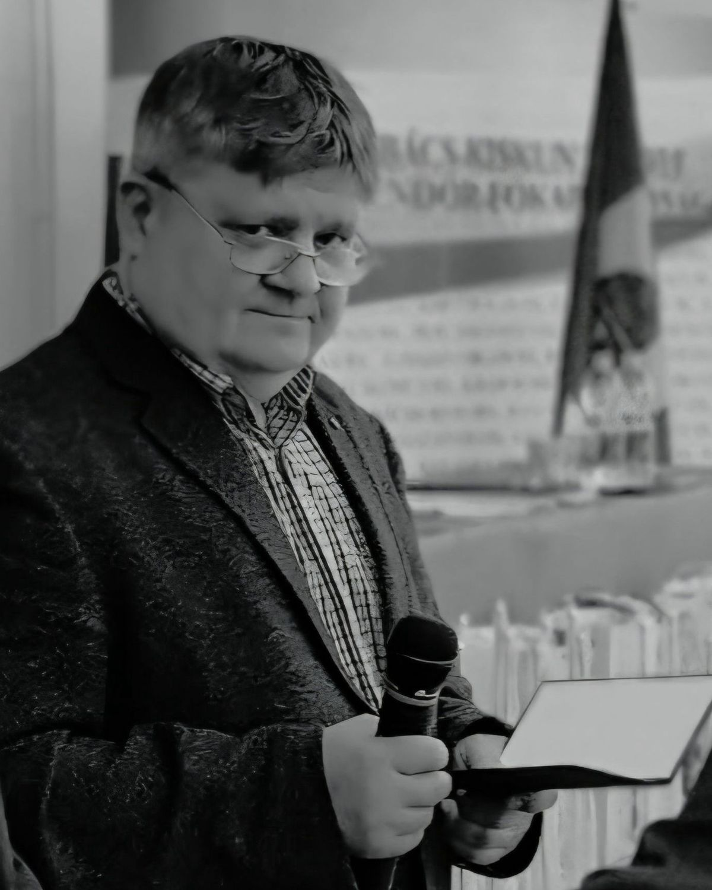
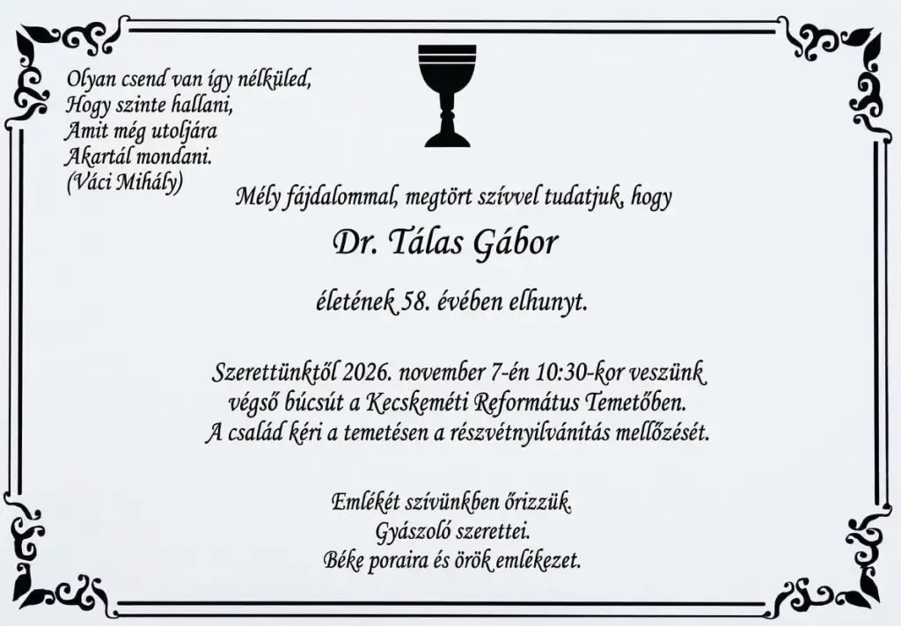

Gábor előbb a Magyar Honvédség 59. Szentgyörgyi Dezső Harcászati Repülőezred, majd a Kecskeméti Rendőrkapitányság, illetve a Bács-Kiskun Megyei Rendőr-főkapitányság, végül a Belügyminisztérium Bevándorlási és Állampolgársági Hivatal Dél-alföldi Regionális Igazgatóság állományában teljesített szolgálatot. Nyugállományba vonulása után nem szakadt el a rendvédelemtől, sem a lakosság szolgálatától. Aktív tagja volt a Solti Polgárőr Egyesületnek, ellátta a Személy-, Vagyonvédelmi és Magánnyomozói Szakmai Kamara Bács-Kiskun Megyei Szervezetének titkári feladatait, illetve a Bács-Kiskun Vármegyei Polgárőr Szövetség jogi munkáját segítette. Mi az utóbbi tevékenysége kapcsán ismertük meg Őt. Azonnali és érdemi segítséget nyújtott minden megkeresésünknél szervezetünk működése jogi megfelelőségének érdekében, legfőképen az Alapszabály megalkotásánál, illetve a törvényszéki bejegyzéseknél. Mindezt önzetlenül tette, merthogy ilyem Ember volt.

Gábor! Köszönünk mindent. Isten veled!

